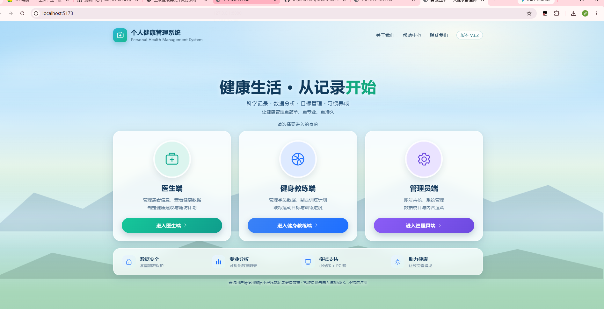
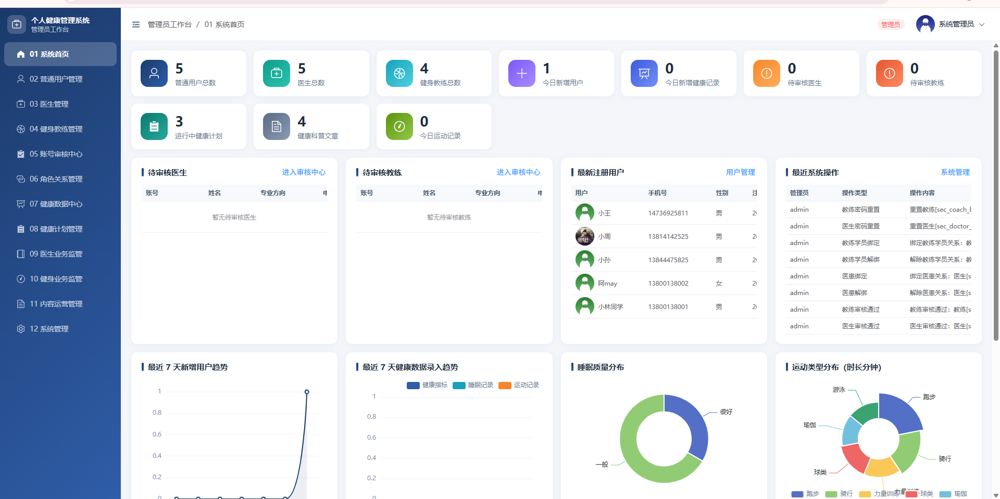
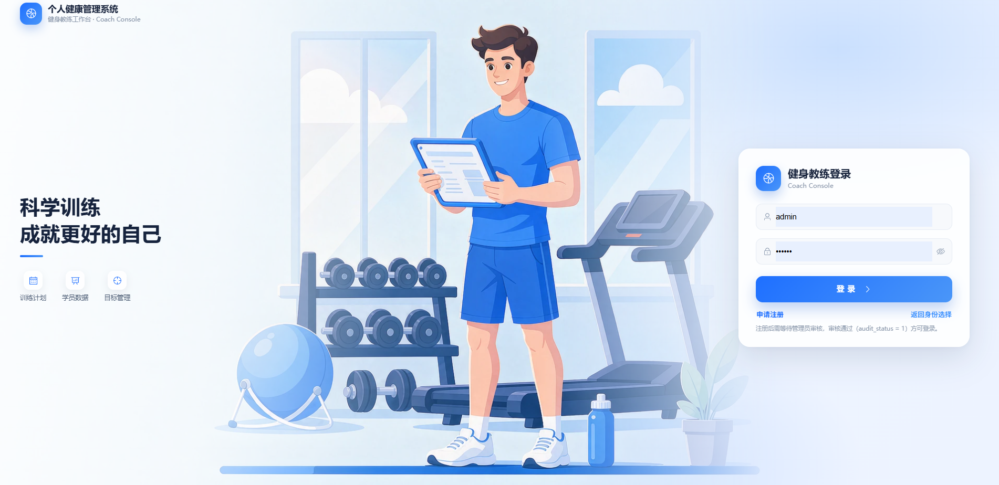
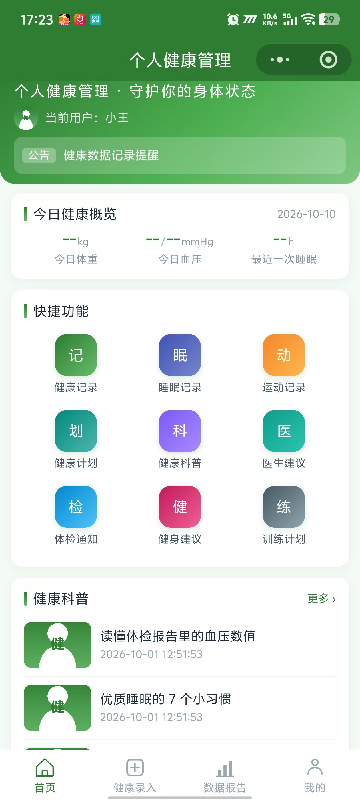
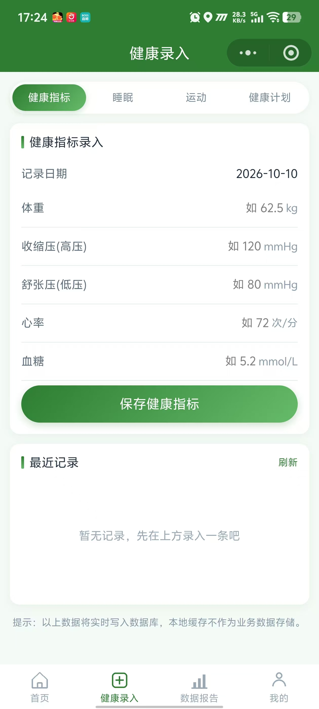
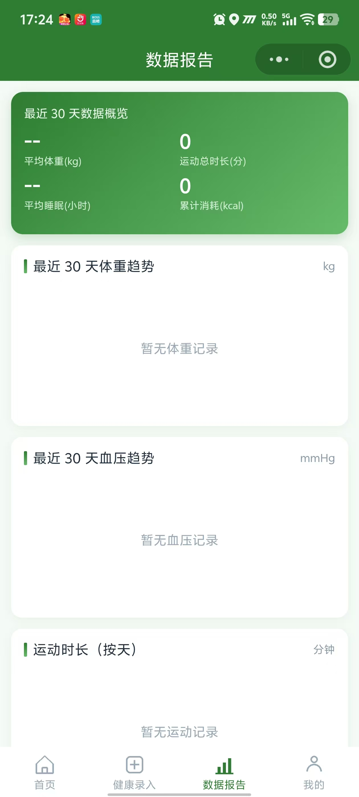
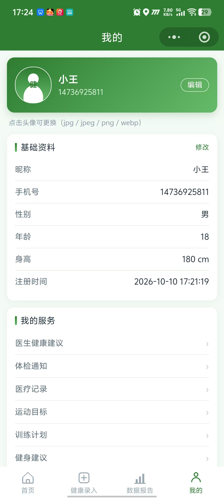

# 个人健康管理系统

**Personal Health Management System · V3.2 FINAL**

> 基于 **UniApp + Vue3 + Flask + MySQL** 的四角色健康管理系统，包含微信小程序、医生工作台、健身教练工作台与管理员后台。

    

本项目用于**个人健康数据记录、趋势展示与毕业设计/学习演示**。医生和健身教练可以在授权关系内提供人工建议；系统不提供自动疾病诊断、处方或医疗决策。

## 项目亮点

- **四角色协同**：普通用户、医生、健身教练、管理员，各有独立登录与权限边界。
- **双前端架构**：UniApp 微信小程序面向用户；Vue3 + Element Plus PC 端面向业务人员与管理员。
- **真实数据可视化**：健康指标、睡眠、运动与健康计划使用 MySQL 数据展示趋势和统计。
- **关系级数据隔离**：医生仅可访问已绑定患者；教练仅可访问已绑定学员；后端校验 JWT 角色与数据归属。
- **完整管理后台**：12 个一级管理模块，覆盖审核、绑定、数据监管、内容运营和操作日志。
- **工程化交付**：数据库初始化脚本、接口文档、自动化测试与部署说明。

## 界面预览

目前 README 未包含已入库的截图资源。建议将**脱敏后的真实界面截图**放入 `docs/screenshots/`，然后启用以下示例：

```md


```

> 截图请隐藏手机号、真实姓名、头像及健康隐私信息；在图片文件确实上传到仓库之前，不使用失效的图片链接。

## 快速导航

- [四角色介绍](#一四角色介绍) · [技术栈](#二技术栈) · [项目目录](#三项目目录)
- [环境准备](#四环境准备) · [数据库导入](#五数据库导入) · [后端启动](#六后端python-环境--依赖--env--启动)
- [PC 端启动](#七pc-管理端启动) · [小程序启动](#八微信小程序启动hbuilderx)
- [管理员模块](#十八管理员-12-个一级模块说明) · [验证脚本](#二十一验证脚本使用)
- [安全配置](#二十三jwt_secret-配置与安全约定) · [验收结果](#二十四最终验收结果v32-final-封板)

## 运行架构

```text
微信小程序（普通用户） ──────┐
                             ├── Flask REST API（8080）── MySQL 8.0
PC Web（医生 / 教练 / 管理员）─┘            │
                                        └── static/upload 图片存储
```

> **公开仓库说明**：GitHub 仅存放源代码与非敏感示例配置。实际运行需要自行配置 MySQL、环境变量、后端服务与小程序局域网 IP；克隆仓库不代表系统已部署上线。

---

## 一、四角色介绍

| 角色 | role | 使用终端 | 入口 | 账号来源 |
| --- | --- | --- | --- | --- |
| 普通用户 | 0 | UniApp + Vue3 微信小程序 | 小程序首页 | 自主注册，注册后可直接登录 |
| 医生 | 1 | Vue3 + Element Plus PC 端 | `/doctor/login` | 自主申请注册 → 管理员审核通过方可登录 |
| 健身教练 | 2 | Vue3 + Element Plus PC 端 | `/coach/login` | 自主申请注册 → 管理员审核通过方可登录 |
| 管理员 | 3 | Vue3 + Element Plus PC 端 | `/admin/login` | 数据库初始化，**禁止公开注册** |

### 角色能力

- **普通用户**：记录健康指标 / 睡眠 / 运动，创建健康计划，查看数据报告（趋势图表）、健康科普、
  系统公告，接收医生健康建议、体检通知、医疗记录，接收教练的运动目标、训练计划、健身建议。
- **医生**：管理自己的患者（仅 `doctor_patient` 中与本人绑定的患者），查看患者只读健康数据与趋势，
  填写健康建议 / 体检通知 / 医疗记录，维护个人资料。
- **健身教练**：管理自己的学员（仅 `coach_student` 中与本人绑定的学员），查看学员只读运动数据，
  制定运动目标 / 训练计划 / 健身建议，维护个人资料。
- **管理员**：固定 **12 个一级模块** —— 账号审核、人员管理、角色关系、健康数据监管、健康计划监管、
  医生业务监管、健身业务监管、内容运营与系统审计。

---

## 二、技术栈

| 层 | 技术 |
| --- | --- |
| 普通用户小程序 | UniApp + Vue3（`<script setup>`）+ JavaScript + uCharts 2.5.0 |
| PC 管理端 | Vue3 + Vite 5 + Element Plus + Vue Router 4 + Axios + ECharts |
| 后端 | Python 3 + Flask + PyMySQL + PyJWT + Werkzeug + Flask-CORS |
| 数据库 | MySQL 8.0（字符集 `utf8mb4`，`utf8mb4_general_ci`） |

---

## 三、项目目录

```text
health-management-system/
├── backend/                        # Python Flask 统一后端
│   ├── app.py                      # 应用入口（0.0.0.0:8080）
│   ├── config.py                   # 统一配置（全部来自环境变量）
│   ├── requirements.txt
│   ├── .env.example                # 环境变量示例（复制为 .env 使用）
│   ├── .env                        # 本地真实配置（不要提交到版本库）
│   ├── routes/                     # 路由层：user / health / doctor / coach / admin / article / notice
│   ├── services/                   # 业务服务层（全部 SQL 参数化）
│   ├── utils/                      # db / jwt_utils / auth / response / upload / security / audit_log / helpers
│   └── static/upload/              # 图片统一存储目录（数据库只存文件名）
├── miniapp/                        # UniApp 微信小程序（普通用户端）
│   ├── pages/                      # 15 个业务页面
│   ├── components/u-charts/        # uCharts 官方库 + 封装组件
│   ├── common/                     # config / request / auth
│   ├── api/index.js                # 统一接口层
│   ├── pages.json / manifest.json / App.vue / main.js
│   └── static/tabbar/              # TabBar 图标
├── management-web/                 # Vue3 PC 管理端（医生 / 教练 / 管理员）
│   ├── src/router/                 # doctor.js / coach.js / admin.js / index.js（路由 + 守卫）
│   ├── src/views/                  # portal / doctor / coach / admin
│   ├── src/api/                    # request.js（三角色独立实例）+ doctor/coach/admin
│   ├── src/components/             # BaseLayout / StatCard / ChartBox / PatientSelect / RoleProfile
│   ├── src/utils/                  # config / auth / format / download
│   ├── .env.development / .env.production
│   └── vite.config.js
├── database/
│   └── health_management.sql       # 建库 + 19 张表 + 索引 + 外键 + 初始化测试账号
├── docs/
│   ├── API.md                      # 接口文档（四角色分组）
│   ├── DATABASE.md                 # 数据库文档（表 / 字段 / 关系 / 索引）
│   ├── TEST_REPORT.md              # 测试报告
│   └── FINAL_REPORT.md             # 最终完成报告
├── tests/                          # 验证脚本与结果（真实 HTTP + 真实 MySQL）
│   ├── api_test.py                 # 接口 / 权限 / 安全 自动化测试（198 项）
│   ├── backend_selfcheck.py        # 后端语法编译 + 路由清单 + 端口/敏感项扫描
│   ├── miniapp_check.py            # 小程序静态检查（23 项）
│   ├── web_check.py                # PC 端静态检查（33 项）
│   └── *_result.json / *.txt       # 以上脚本的运行结果存档
├── tools/                          # 资产与哈希生成工具（不参与运行时）
│   ├── gen_tabbar_icons.py         # 生成 TabBar 图标
│   ├── gen_default_avatars.py      # 生成四类默认头像
│   ├── fetch_ucharts.js            # 拉取 uCharts 官方库
│   └── gen_password_hash.py        # 生成 Werkzeug 兼容密码哈希
└── README.md
```

---

## 四、环境准备

- Python 3.8+（推荐 3.10+）
- Node.js 18+（构建 PC 端）
- MySQL 8.0
- HBuilderX（运行小程序）或 微信开发者工具

---

## 五、数据库导入

1. 确认本机 MySQL 已启动（默认 `3306`）。
2. 执行初始化脚本（会自动 `CREATE DATABASE health_management` 并建表 + 写入初始化账号）：

```bash
mysql -uroot -p < database/health_management.sql
```

3. 校验（应输出 19 张表）：

```sql
USE health_management;
SHOW TABLES;
SELECT id, admin_name, real_name FROM admin_user;
```

> 脚本结尾会为下表 7 个账号写入**Werkzeug 安全哈希**（`pbkdf2:sha256`），数据库中不存在明文密码。

---

## 六、后端：Python 环境 / 依赖 / .env / 启动

```bash
cd backend

# 1) 安装依赖
python -m pip install -r requirements.txt

# 2) 配置环境变量
copy .env.example .env        # Windows（Linux/macOS 用 cp）
#   然后编辑 .env，至少修改 DB_PASSWORD 与 JWT_SECRET
```

`.env` 含真实密钥，已被 `.gitignore` 忽略、**绝不提交版本控制**；仓库内仅保留 `.env.example` 占位模板。`.env` 关键项：

```ini
FLASK_HOST=0.0.0.0
FLASK_PORT=8080              # 固定 8080，禁止 5000 / 5001
FLASK_DEBUG=False
DB_HOST=127.0.0.1
DB_PORT=3306
DB_USER=root
DB_PASSWORD=你的MySQL密码
DB_NAME=health_management
DB_CHARSET=utf8mb4
JWT_SECRET=请替换为高强度随机字符串
JWT_EXPIRE_HOURS=72
API_BASE_URL=/api                     # 生产同源相对路径（Web Server 反代到 Flask:8080）
STATIC_BASE_URL=/static/upload/       # 生产同源相对路径
MAX_CONTENT_LENGTH_MB=10
```

启动：

```bash
python app.py
```

启动日志示例：

```text
[INFO] health-backend: 已注册路由数量: 126
[INFO] health-backend: 数据库自检: 数据库连接正常
[INFO] health-backend: 服务启动于 http://0.0.0.0:8080
```

**端口说明**：后端固定 **8080**，全项目已扫描确认不存在 5000 / 5001。

---

## 七、PC 管理端启动

```bash
cd management-web

npm install            # 首次执行（网络慢可加 --registry=https://registry.npmmirror.com）

npm run dev            # 开发模式：http://localhost:5173
npm run build          # 生产构建，产物输出到 dist/
npm run preview        # 预览生产构建
```

浏览器打开 `http://localhost:5173` → 显示 **身份选择页**（医生 / 健身教练 / 管理员）。

### 生产部署要点

- `dist/` 为纯静态产物，可部署到 Nginx / 静态托管。
- 生产采用**同源部署**：`.env.production` 中 `VITE_API_BASE_URL=/api`、`VITE_STATIC_BASE_URL=/static/upload/`，
  由 Web Server（Nginx 等）把 `/api`、`/static/upload/` 反向代理到 Flask `127.0.0.1:8080`。
- 由于使用 HTML5 History 路由，Nginx 需配置 `try_files $uri $uri/ /index.html;`。
- 开发环境通过 Vite 代理 `/api`、`/static` 到 `VITE_PROXY_TARGET`（默认 `http://127.0.0.1:8080`），
  因此开发时不需要改 IP，也不存在跨域问题。

---

## 八、微信小程序启动（HBuilderX）

1. 用 HBuilderX 打开 `miniapp/` 目录（**打开目录**，不是打开单个文件）。
2. 修改 `miniapp/common/config.js`：

```js
export const API_BASE_URL = 'http://<你的电脑局域网IP>:8080/api'
export const STATIC_BASE_URL = 'http://<你的电脑局域网IP>:8080/static/upload/'
```

3. 运行时勾选「不校验合法域名」（微信开发者工具 → 详情 → 本地设置）。
4. 菜单：**运行 → 运行到小程序模拟器 → 微信开发者工具**。

---

## 九、微信开发者工具运行（不使用 HBuilderX）

1. HBuilderX 中先执行 **发行 → 小程序-微信**，产物位于 `miniapp/unpackage/dist/build/mp-weixin`。
2. 打开微信开发者工具 → 导入项目 → 选择该产物目录。
3. 项目 AppID 使用测试号即可；同样需要关闭合法域名校验（本地开发）。

---

## 十、API 配置位置（唯一来源，禁止页面内硬编码 IP）

| 端 | 文件 | 说明 |
| --- | --- | --- |
| 小程序 | `miniapp/common/config.js` | `API_BASE_URL` / `STATIC_BASE_URL` |
| PC 端 | `management-web/src/utils/config.js` | 读取 `VITE_API_BASE_URL`，兜底 `/api` |
| PC 端（开发） | `management-web/.env.development` | `/api` + Vite 代理（无需改 IP） |
| PC 端（生产） | `management-web/.env.production` | `/api` + `/static/upload/`（**同源**，由 Web Server 反代） |

---

## 十一、图片目录与访问地址

- 存储目录：`backend/static/upload/`
- 访问前缀：`http://<host>:8080/static/upload/`
- **数据库中只保存文件名**（例如 `abc123.jpg`），不保存完整 URL。
- 允许扩展名：`jpg` / `jpeg` / `png` / `webp`；文件名使用 `UUID + 原始扩展名`。
- 四类默认头像：`default_health.jpg`、`default_doctor.jpg`、`default_coach.jpg`、`default_admin.jpg`
- **小程序图片地址统一入口**：`miniapp/common/image.js` 的 `imgSrc(文件名)`
  （= `resolveFileUrl()` + 真机 http 图片本地化）。真机上 `<image>` 组件会被客户端拦截
  `http://` 网络图片，故该函数先经 `uni.downloadFile` 落到本地临时文件再渲染；
  `https://` 地址与本地打包资源原样返回。**PC 端与后端不经过此层。**
  （如需重新生成：`python tools/gen_default_avatars.py`）。

---

## 十二、演示账号与初始化数据

项目初始化 SQL 包含用于本地教学演示的角色账号及示例数据。账号清单与初始化逻辑请查看 `database/health_management.sql`，**仅可在隔离的本地测试环境使用**。

> **安全提示**：示例密码不适合公网环境。部署前应更换全部初始化账号密码、数据库密码及 `JWT_SECRET`，禁用或移除不必要的演示账号，且不要将真实用户健康数据提交到公开仓库。

---

## 十三、四角色 Token 体系

| Token 类型 | 签发接口 | JWT 载荷 | 可用接口范围 |
| --- | --- | --- | --- |
| `user_token` | `POST /api/user/login` | `id` / `role=0` / `token_type=user_token` / `exp` | 仅普通用户接口 |
| `doctor_token` | `POST /api/doctor/login` | `id` / `role=1` / `token_type=doctor_token` / `exp` | 仅医生接口 |
| `coach_token` | `POST /api/coach/login` | `id` / `role=2` / `token_type=coach_token` / `exp` | 仅教练接口 |
| `admin_token` | `POST /api/admin/login` | `id` / `role=3` / `token_type=admin_token` / `exp` | 仅管理员接口 |

- 请求头统一：`Authorization: Bearer {token}`
- 后端分别实现 `user_token_required` / `doctor_token_required` / `coach_token_required` / `admin_token_required`，
  校验**签名 + 过期时间 + token_type**，四者互相不可混用。
- **权限最终以后端验证为准**，前端路由守卫只是体验优化，不承担鉴权职责。

---

## 十四、医生注册与审核流程

```text
医生在 /doctor/register 提交申请
  → 后端强制 audit_status=0（客户端传 audit_status=1 会被忽略）
  → 管理员在「05 账号审核中心」查看申请资料
      ├─ 通过 → audit_status=1 → 可登录，签发 doctor_token
      └─ 拒绝 → audit_status=2 → 登录提示「账号审核未通过，请联系管理员」
  → 待审核状态登录提示「账号正在审核中，请耐心等待」，且不签发任何 Token
  → 每次审核写入 admin_operation_log
```

## 十五、教练注册与审核流程

与医生完全一致，接口为 `POST /api/coach/register`、`POST /api/coach/audit`。

## 十六、医患绑定流程

```text
管理员 → 06 角色关系管理 → 医患关系
  → 选择医生 + 选择患者 → 绑定（doctor_patient 表，doctor_id + user_id 唯一约束，重复绑定被拒）
  → 医生端「患者管理」随即出现该患者，可读取其只读健康数据
  → 解除绑定后，医生再次读取该患者 → 401（无权访问该患者数据（未建立医患关系））
```

## 十七、教练学员绑定流程

同医患绑定，接口为 `POST /api/admin/coach/bind_student` / `unbind_student`，
关系表 `coach_student`（`coach_id + user_id` 唯一）。

---

## 十八、管理员 12 个一级模块说明

| 序号 | 模块 | 路由 | 核心能力 |
| --- | --- | --- | --- |
| 01 | 系统首页 | `/admin/dashboard` | 10 项真实 SQL 统计卡 + 7 张图表 + 待办快捷入口 |
| 02 | 普通用户管理 | `/admin/users` | 列表/搜索/筛选 + 用户完整健康档案（7 个 Tab） |
| 03 | 医生管理 | `/admin/doctors` | 查询/筛选、详情、编辑资料、重置密码、患者与业务统计 |
| 04 | 健身教练管理 | `/admin/coaches` | 查询/筛选、详情、编辑资料、重置密码、学员与业务统计 |
| 05 | 账号审核中心 | `/admin/audit` | 待审核概览、医生审核、教练审核、审核记录 |
| 06 | 角色关系管理 | `/admin/relations` | 医患关系与教练学员关系的绑定/解除（防重复） |
| 07 | 健康数据中心 | `/admin/health-data` | 健康指标/睡眠/运动数据查询筛选 + 统计分析 + CSV 导出 |
| 08 | 健康计划管理 | `/admin/plans` | 计划总数与状态统计、按用户/状态/日期筛选监管 |
| 09 | 医生业务监管 | `/admin/doctor-business` | 健康建议 / 体检通知 / 医疗记录监管（只读） |
| 10 | 健身业务监管 | `/admin/coach-business` | 运动目标 / 训练计划 / 健身建议监管（只读） |
| 11 | 内容运营管理 | `/admin/content` | 健康科普与系统公告的新增/编辑/删除/显示隐藏/封面上传 |
| 12 | 系统管理 | `/admin/system` | 操作日志（只读）、管理员个人中心、系统信息 |

> 除实现本需求确实必要外，**不新增一级菜单**，新功能一律放入上述 12 个模块内部。

---

## 十九、常见错误与排查

| 现象 | 原因 | 处理 |
| --- | --- | --- |
| 小程序提示「网络异常，请检查后端服务是否已启动」 | 后端未启动 / IP 写错 / 手机与电脑不同网段 | 确认 `python app.py` 已运行；确认 `common/config.js` 的 IP 为电脑局域网 IP |
| PC 端登录报「网络异常」 | 后端未启动或端口不是 8080 | 确认后端监听 `0.0.0.0:8080`；开发模式确认 Vite 代理生效 |
| 医生登录提示「账号正在审核中，请耐心等待」 | `audit_status=0` | 用管理员账号在「05 账号审核中心」通过审核 |
| 医生打开「患者健康数据」为空 | 该医生尚未绑定患者 | 管理员在「06 角色关系管理」绑定医患关系 |
| 接口返回 `401 无权访问该患者数据（未建立医患关系）` | 医患关系不存在或已被解除 | 属预期权限行为；需管理员重新绑定 |
| PC 端静态资源 404 | 生产构建直接本地打开 `index.html`（History 路由） | 用 Nginx 等 Web 服务器托管 `dist/`，并配置 history fallback |
| `Access denied for user 'root'` | `.env` 中 `DB_PASSWORD` 不正确 | 修改 `backend/.env` 后重启后端 |
| 上传图片失败 | 扩展名不在白名单 / 超过 10MB | 使用 jpg/jpeg/png/webp，且不超过 `MAX_CONTENT_LENGTH_MB` |
| 刷新 PC 页面 404 | Web 服务器未配置前端路由回退 | 配置 `try_files $uri $uri/ /index.html;` |

---

## 二十、局域网访问说明

1. 查询本机局域网 IP：

```bash
ipconfig        # Windows，取 IPv4 地址
```

2. 后端已监听 `0.0.0.0:8080`，同一局域网内的手机 / 其他电脑可直接访问
   `http://<本机IP>:8080/api`。
3. 若无法访问，检查：
   - Windows 防火墙是否放行 `8080`（或 Python 程序的入站规则）；
   - 手机与电脑是否在同一网段（不要一个连 WiFi 一个连热点）；
   - `miniapp/common/config.js` 内的 IP 是否为本机**当前**真实 IP（换网络后需同步修改）。
4. 微信开发者工具中需勾选「不校验合法域名」，否则 `http://` 请求会被拦截。
5. 小程序真机预览时，手机必须与电脑在同一局域网，且手机可访问该 IP。

### 换 Wi-Fi / 换网络后如何修改小程序 IP

1. `ipconfig` 查到本机新的 IPv4 地址（形如 `192.168.x.y`）；
2. 编辑 **`miniapp/common/config.js`**（全项目**唯一**网络配置入口），把 `API_BASE_URL` /
   `STATIC_BASE_URL` 的 IP 换成新值，**端口保持 `8080`**；
3. 重新运行小程序即可；**PC 端无需修改**——开发态走 Vite 代理，生产态走同源相对路径 `/api`。

> 除 `miniapp/common/config.js` 外，任何页面都**不得**再出现 IP 字面量（已静态扫描确认 = 0）。


---

## 二十一、验证脚本使用

所有验证脚本均位于 `tests/`，使用真实 HTTP 请求与真实 MySQL 查询，**不使用 Mock**。

```bash
cd tests

python backend_selfcheck.py     # 后端：语法编译 + 126 条路由清单 + 端口/敏感项扫描
python api_test.py              # 接口/权限/安全：199 项（需后端已启动）
python miniapp_check.py         # 小程序静态检查：23 项
python web_check.py             # PC 端静态检查：33 项
```

运行结果分别写入 `tests/*_result.json`、`tests/backend_selfcheck.txt`。
> `api_test.py` 会创建**带唯一时间戳标识**的测试账号与测试数据用于真实联调，并在 `finally` 中
> **精确清理本轮创建的数据**（白名单 + 守卫，绝不模糊删除、绝不动既有数据）；运行前后业务表计数一致，残留恒为 0。

---

## 二十二、医疗业务边界声明

系统**允许**：健康数据记录、趋势展示、医生人工填写健康建议、体检通知、医疗/健康管理记录、
运动目标、训练计划、健身建议。

系统自动逻辑**禁止**：疾病确诊、自动诊断、自动处方、处方药推荐、声称替代医生诊断。

首页健康预警仅输出提示文案：

> 检测到部分健康指标可能超出常见参考范围，请注意关注身体状态；如持续异常，请咨询专业医疗人员。


---

## 二十三、JWT_SECRET 配置与安全约定

- **算法 / 载荷 / 时效未改**：HS256、四角色 `token_type` 隔离、有效期 `JWT_EXPIRE_HOURS=72`。
- **密钥只经环境变量进入后端**：`backend/.env` → `config.py` → `utils/jwt_utils.py`；产品源码**无硬编码**。
- **生成方式**（不要用固定串 / 项目名+日期 / `123456` / UUID）：

```bash
python -c "import secrets;print(secrets.token_urlsafe(64))"
```

  将输出写入 `backend/.env` 的 `JWT_SECRET`（≥32 bytes 熵，推荐 64 bytes）。
- **安全失败策略**：`JWT_SECRET` 缺失或仍为占位值时，**后端启动阶段直接报配置错误**，不会回落到固定默认密钥。
- **`.env` 不提交版本控制**：`backend/.env`、`management-web/.env.*` 均被 `.gitignore` 忽略；
  仓库内只保留 **`.env.example`** 占位模板（`JWT_SECRET=CHANGE_ME_TO_A_STRONG_RANDOM_SECRET`）。
- **轮换影响**：更换 `JWT_SECRET` 后旧 Token 全部失效——这是**正确的安全行为**，四角色需重新登录；
  系统**不保留旧密钥、不实现双密钥、不降低校验**。

---

## 二十四、最终验收结果（V3.2 FINAL 封板）

| 项目 | 结果 |
| --- | --- |
| 后端自检 `backend_selfcheck.py` | **5 / 5 PASS**（126 条路由） |
| 小程序静态检查 `miniapp_check.py` | **23 / 23 PASS** |
| PC 端静态检查 `web_check.py` | **33 / 33 PASS** |
| 接口联调 `api_test.py` | **199 / 199 PASS** |
| 权限 + 异常专项 A~K | **197 / 197 PASS** |
| 四角色真实冒烟 | **46 / 46 PASS** |
| Vite 生产构建（同源 `/api`） | **PASS** |
| Secret 泄露扫描（旧/新 JWT Secret、DB 密码、Bearer、dist） | **命中 0** |
| 数据库完整性 | 19 表 · 结构指纹未变 · 无孤儿 · 临时数据残留 0 |
| 受保护数据（小林同学 / 阿may / 小孙 / 小周 + doctor001-003 + coach001-003 及绑定） | **INTACT** |

**结论**：`PROJECT_FINAL_SEAL = PASS`。完整记录见 **`docs/FINAL_PROJECT_SEAL_REPORT.md`**。

---

## 使用范围与免责声明

本项目面向学习、研究和毕业设计演示。所有健康指标、报告与建议仅供健康管理信息展示，不替代专业医疗诊断、治疗或急救服务。请勿将真实个人健康信息、账号凭据或生产数据库备份提交到公开仓库。

**开源许可**：当前仓库未声明许可证；如需授权他人复制、修改或再分发，请在明确选择许可证后添加 `LICENSE` 文件。


---


## PC 管理后台

### 后台首页（身份选择）



### 管理员登录页


### 管理员工作台



### 医生端登录页


### 健身教练端登录页



---


## 微信小程序

### 微信小程序

<table>
  <tr>
    <th>小程序首页</th>
    <th>健康数据录入</th>
    <th>健康数据报告</th>
    <th>个人中心</th>
  </tr>
  <tr>
    <td></td>
    <td></td>
    <td></td>
    <td></td>
  </tr>
</table>

